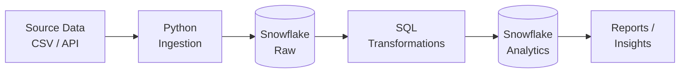

# Hi, I'm Sharad Kamble 👋

### Junior Data Engineer · Data Support Engineer
**SQL · Snowflake · Python · PySpark**

📍 Pune, Maharashtra, India · 🟢 **Open to work now**

---

## 🚀 About Me

I'm moving into Data Engineering from a **Technical Support (SQL / Linux)** role. Day to day I troubleshoot real database and Linux issues, so I know what breaks in production and how to find the root cause. I'm now using that experience to build reliable, well-documented data pipelines.

- 🎯 **Core focus:** SQL · Snowflake · Python
- 💼 Hands-on **production support** experience with SQL and Linux
- ⚡ Interested in **SQL performance tuning** and **Spark performance optimization**
- 🎓 **Microsoft certified:** AZ-900, DP-900, AI-900
- 🏅 **Databricks** PySpark credential · **Snowflake** badge
- 🔎 **Looking for:** Junior Data Engineer · Data Support Engineer · SQL-heavy Data Analyst roles

---

## 🛠️ Tech Stack

**Core skills** *(my main focus)*

**Databases**

**Big Data & Processing**

**Cloud & Platforms** *(learning)*

**Streaming & Orchestration** *(learning)*

**Dev Tools**

---

## 🧠 What I'm Learning

| Area | Topics |
|---|---|
| ❄️ **Snowflake** | Data loading · Zero-Copy Cloning · Time Travel · Fail-safe · Data sharing · Semi-structured data |
| 🗄️ **SQL** | Joins · Window functions · CTEs · Stored procedures · Indexing · Query optimization |
| 🐍 **Python** | Python for data engineering · Scripting and automation |
| ⚡ **Spark** | Spark architecture · PySpark · Performance optimization |
| 🧱 **Lakehouse** | Databricks · Delta Lake · Medallion Architecture (Bronze / Silver / Gold) |
| ⚙️ **Orchestration** | Apache Airflow · Kafka · Spark Structured Streaming *(next)* |
| ☁️ **Cloud** | Azure fundamentals · Microsoft Fabric |

---

## 📂 Repositories

| Repository | What's inside |
|---|---|
| 🗄️ [Sql](https://github.com/learncloud-sharad/Sql) | SQL practice: joins, window functions, CTEs, stored procedures, indexing, query optimization |
| 🐍 [Python-Practice](https://github.com/learncloud-sharad/Python-Practice) | Python exercises toward data pipeline work |

*Forked repos (complete_sql_foundations, pyspark500) are course material I'm studying from.*

---

## 🏗️ Projects

Each project gets its own repository with a README, architecture diagram and steps to run it.

| # | Project | Tech | Status |
|---|---|---|---|
| 1 | End-to-end pipeline: raw data to analytics-ready tables | Python, Snowflake, SQL | 🔨 **In progress** |
| 2 | Medallion Architecture pipeline (Bronze / Silver / Gold) | Databricks, PySpark, Delta Lake | 🔜 Next |
| 3 | Scheduled, orchestrated pipeline | Airflow, Python, Snowflake | 🔜 Later |

**Project 1 flow**

---

## 📈 Skill Progress

| Status | Skill |
|---|---|
| ✅ | SQL: production experience, tuning in progress |
| 🔄 | Snowflake · Python · PySpark · Databricks & Delta Lake |
| 🔄 | Git & GitHub · Microsoft Fabric (DP-600 / DP-700 prep) |
| 🔜 | Airflow · Kafka & Structured Streaming · AWS data services |

✅ Solid · 🔄 In progress · 🔜 Up next

---

## 🏆 Certifications

🎯 **Preparing for:** DP-600 (Fabric Analytics Engineer) · DP-700 (Fabric Data Engineer)

---

## 🤝 Let's Connect

I'm actively looking for a junior Data Engineer or data support role. If you're hiring or have advice, I'd love to hear from you.

💼 [LinkedIn](https://www.linkedin.com/in/sharadkambledataengineer/) · 📧 sharadkamblej@outlook.com · 📍 Pune, Maharashtra, India

⭐ *Always learning, always building, always improving.*
