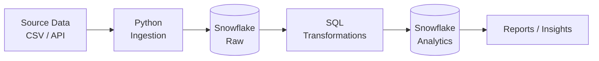

# Hi, I'm Sharad Kamble 👋

**Pune, Maharashtra, India** · Open to Data Engineer roles from November 2026

---

## 🚀 About Me

I'm moving into **Data Engineering** from a **Technical Support (SQL / Linux)** role. Day to day I troubleshoot real database and Linux issues, and I'm now building strong skills in **SQL, Snowflake and Python** so I can design and run reliable data pipelines.

- 🎯 **Core focus:** SQL · Snowflake · Python
- 💼 Hands-on production support experience with SQL and Linux
- ⚡ Passionate about **SQL performance tuning**
- 🎓 Microsoft certified (AZ-900, DP-900, AI-900), preparing for **DP-600, DP-700 and DP-750**
- 🏅 Databricks PySpark credential and a Snowflake badge
- 🔎 **Open to Data Engineer opportunities from November 2026**

---

## 🛠️ Tech Stack

**Core skills (my main focus right now)**

**Databases**

**Tools**

**Concepts:** ETL / ELT · Data Pipelines · Data Modeling · Data Quality · Query Optimization

---

## 📂 Repositories

| Repository | What's inside |
|---|---|
| 🗄️ [**Sql**](https://github.com/learncloud-sharad/Sql) | SQL basics, joins, window functions, CTEs, stored procedures, indexing, query optimization |
| 🐍 [**Python-Practice**](https://github.com/learncloud-sharad/Python-Practice) | Python programs and exercises, building the foundation for data pipelines |
| ❄️ **Snowflake** | *Coming soon: Snowflake SQL practice and hands-on work* |

---

## 🏗️ Next Project: End-to-End Pipeline (Planned)

My first portfolio project will take raw data through a full pipeline using **Python, Snowflake and SQL**.

> 🚧 Starting end of October 2026. Repository will be added here.

---

## 📈 Learning Roadmap

| Status | Skill |
|:---:|---|
| 🔄 | SQL (advanced queries, performance tuning) |
| 🔄 | Snowflake |
| 🔄 | Python for data engineering |
| 🔄 | Git & GitHub |
| 🔄 | Microsoft Fabric (DP-600 / DP-700 prep) |
| 🔜 | Databricks & PySpark (hands-on projects) |
| 🔜 | Azure data services |
| 🔜 | Apache Airflow |
| 🔜 | AWS data engineering |

🔄 In progress · 🔜 Up next

---

## 🏆 Certifications

<!-- TODO: replace "PySpark_Developer" and "Badge" above with the exact credential names from LinkedIn -->

🎯 **In progress:** DP-600 (Fabric Analytics Engineer) · DP-700 (Fabric Data Engineer) · DP-750

---

## 🤝 Let's Connect

I'm preparing for **Data Engineer** roles starting November 2026. Feel free to reach out!

- 💼 **LinkedIn:** [linkedin.com/in/sharadkambledataengineer](https://www.linkedin.com/in/sharadkambledataengineer)
- 💻 **GitHub:** [github.com/learncloud-sharad](https://github.com/learncloud-sharad)
- 📧 **Email:** sharadkamblej@outlook.com
- 📍 **Location:** Pune, Maharashtra, India

⭐ *Always learning, always building, always improving.*

