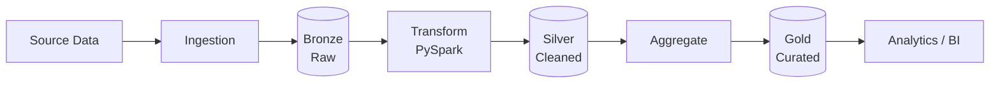

# Hi, I'm Sharad Kamble 👋

**Pune, Maharashtra, India** · Open to Data Engineer roles

---

## 🚀 About Me

I'm a **Data Engineer** with hands-on experience in **SQL, Python, Snowflake, the Azure data platform and Microsoft Fabric**. I enjoy building reliable data pipelines, learning modern cloud tools, and tuning SQL for performance.

- 💼 Technical Support Specialist (SQL / Linux), which gives me strong production troubleshooting skills
- 🎓 Preparing for **DP-750** and **DP-700**
- 🔧 Passionate about **SQL performance tuning**
- 📚 Currently learning **PySpark, Microsoft Fabric, Apache Airflow and AWS**
- 🛠️ Building Data Engineering portfolio projects
- 🔎 **Open to Data Engineer opportunities**

---

## 🛠️ Tech Stack

**Languages**

**Databases & Warehouses**

**Cloud & Data Platforms**

**Big Data**

**Tools**

**Data Engineering Concepts:** ETL / ELT · Data Pipelines · Data Transformation · Data Quality · Schema Evolution · Incremental Loading · Medallion Architecture

---

## 📊 Featured Project

### 🗄️ [SQL Learning Repository](https://github.com/learncloud-sharad/Sql)

A hands-on SQL repository with practical queries and examples, from basics to performance tuning.

| Topic | Topic | Topic |
|---|---|---|
| SQL Basics | Joins | Window Functions |
| CTEs | Stored Procedures | Indexing |
| Query Optimization | Snowflake SQL | |

🔗 **[View Repository →](https://github.com/learncloud-sharad/Sql)**

---

## 🏗️ In Progress: End-to-End Data Pipeline

A portfolio project built on the **Medallion Architecture**, which I'm currently working on.

> 🚧 Repository coming soon. Watch this space.

---

## 📈 Learning Roadmap

| Status | Skill |
|:---:|---|
| ✅ | SQL |
| ✅ | Git & GitHub |
| ✅ | Python Basics |
| ✅ | Snowflake |
| 🔄 | PySpark |
| 🔄 | Microsoft Fabric |
| 🔄 | Apache Airflow |
| 🔄 | AWS Data Engineering |
| 🔄 | DP-750 Certification |

---

## 🏆 Certifications

🎯 **In progress:** DP-750 · DP-600 . DP-700

---

## 📊 GitHub Stats

---

## 🤝 Let's Connect

I'm actively looking for **Data Engineer** opportunities. Feel free to reach out!

- 💼 **LinkedIn:** [linkedin.com/in/sharadkambledataengineer](https://www.linkedin.com/in/sharadkambledataengineer)
- 💻 **GitHub:** [github.com/learncloud-sharad](https://github.com/learncloud-sharad)
- 📧 **Email:** sharadkamblej@gmail.com
- 📍 **Location:** Pune, Maharashtra, India

⭐ *Always learning, always building, always improving.*

